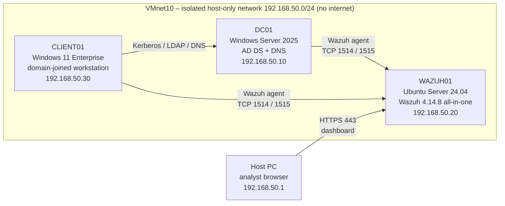

# Home SOC Lab

A small, isolated enterprise environment built at home to practice the work of a
Tier 1 SOC analyst: collecting Windows security logs into a SIEM, generating
controlled attack activity, investigating the alerts, mapping them to
MITRE ATT&CK and writing incident reports.

**Stack:** Windows Server 2025 (Active Directory) · Windows 11 Enterprise ·
Wazuh 4.14.8 SIEM on Ubuntu Server 24.04 · VMware Workstation · PowerShell · Python

---

## Architecture



| VM | Role | OS | vCPU / RAM |
|---|---|---|---|
| DC01 | Domain Controller, DNS | Windows Server 2025 Standard (eval) | 2 / 2.5 GB |
| CLIENT01 | Domain workstation | Windows 11 Enterprise (eval) | 2 / 3 GB |
| WAZUH01 | SIEM: manager, indexer, dashboard | Ubuntu Server 24.04 LTS | 4 / 6 GB |

Host: Intel i5-1235U, 16 GB RAM. WAZUH01 runs below Wazuh's recommended 8 GB,
which caused indexer stalls under load (see [troubleshooting](docs/troubleshooting.md)).

---

## What I built

1. **Isolated network** – VMware host-only network with static IPs and no default
   gateway, so attack simulations cannot leave the lab.
2. **Active Directory** – domain `soclab.local`, OU structure (`TLV > Users`,
   `TLV > Workstations`) and standard users, built with PowerShell
   ([`scripts/setup-ad.ps1`](scripts/setup-ad.ps1)).
   [Screenshot](screenshots/07-ad-ou-structure.png)
3. **Domain-joined workstation** – Windows 11 joined to the domain and placed in
   its own OU, so Group Policy can target it.
4. **SIEM** – Wazuh all-in-one on Ubuntu Server (no GUI), with agents on DC01 and
   CLIENT01.
5. **Audit policy** – an Advanced Audit Policy GPO (Logon, Account Lockout,
   Credential Validation, Kerberos, User and Security Group Management – Success
   and Failure), verified with `auditpol`.
   [Screenshot](screenshots/08-audit-policy-auditpol.png)
6. **Account lockout policy** – 5 failed attempts / 15 minutes.

---

## Attack scenarios and detections

All activity was generated deliberately inside the isolated lab.

| # | Scenario | Windows events | Wazuh rule (level) | MITRE ATT&CK | Report |
|---|---|---|---|---|---|
| 1 | Password guessing against a domain user, ending in lockout | 4625, 4740 | 60122 (5), 60115 (9) | T1110.001 Brute Force: Password Guessing | [IR-001](reports/incident-001-brute-force.md) |
| 2 | New domain account created | 4720 | 60109 (8) | T1136.002 Create Account: Domain Account | [IR-002](reports/incident-002-domain-admin-persistence.md) |
| 3 | New account added to Domain Admins 98 s later, same logon session | 4728 | 60159 (12) | T1098.007 Additional Local or Domain Groups | [IR-002](reports/incident-002-domain-admin-persistence.md) |

**Key findings**
- Brute force: 6 failures in ~3 seconds, then lockout. Verified that no successful
  logon (4624) followed – after first confirming that Wazuh collects 4624 at all.
- Persistence: account creation and Domain Admin assignment shared the same
  Logon ID (`0x134b73`), tying both actions to one session. The logs show *which
  account* acted, not *which person* – so the verdict is "suspicious, verify with
  IT", with containment steps in the report.
- Wazuh mapped the group change to T1484; I documented T1098.007 as a more precise
  technique and explained why.

---

## Python: failed logon analyzer

[`scripts/failed_logins.py`](scripts/failed_logins.py) reads Wazuh alert files
(including compressed daily archives), keeps failed Windows logons (4625), counts
them by user and host, and flags bursts of `N` failures within `T` seconds.

```bash
# Run on the Wazuh server (alert files are readable by root only)
sudo python3 failed_logins.py \
    /var/ossec/logs/alerts/2026/Oct/ossec-alerts-11.json.gz \
    /var/ossec/logs/alerts/alerts.json \
    --threshold 5 --window 60
```

```
Possible brute force (>= 5 failures within 60s):
  [!] dana.levi from CLIENT01: 6 failures in 9s (2026-10-11 14:31:09 -> 14:31:18)
  [!] dana.levi from CLIENT01: 6 failures in 3s (2026-10-11 15:27:02 -> 15:27:05)
```

- Results were **validated against the Wazuh dashboard** (same counts and times).
- A single mistyped Administrator password was correctly *not* flagged.
- Accepts several files, because Wazuh rotates its alert file daily and an attack
  can be split across two files.
- Tested threshold tuning: raising the threshold to 7 missed both attacks (false
  negative); a 5-second window missed the slower one.

[Screenshot](screenshots/06-python-failed-logins-output.png)

---

## What I learned

- **A SIEM only sees what is logged.** Default Windows auditing missed events I
  needed, and applying the audit GPO silently disabled two subcategories until I
  compared `auditpol` before and after.
- **"No results" is not "it didn't happen."** First confirm the event type is
  collected, then check the source host.
- **Check the source of every alert.** Unexpected SSH brute force alerts turned out
  to be my own logins – a false positive found by checking `agent.name` and time.
- **Infrastructure problems become detection gaps.** When the host ran out of
  resources, the indexer stalled and real attack events were lost.
- **Consistent time matters.** One VM in Pacific Time broke the timeline; Wazuh
  itself stores UTC.
- **Logon IDs connect events.** Matching Logon IDs linked two separate actions to
  one session.

Details: [docs/troubleshooting.md](docs/troubleshooting.md)

---

## What I would do differently in production

- Two or more Domain Controllers for redundancy (the lab has one).
- Separate admin accounts per person instead of the built-in Administrator, and
  unique passwords for every account.
- Server Core for the DC to reduce attack surface.
- A routable domain name (e.g. `ad.company.com`) instead of `.local`.
- A CA-signed certificate for the Wazuh dashboard instead of a self-signed one.
- Wazuh sized to the official requirements, with alert retention planned.

---

## Repository structure

```
home-soc-lab/
├── README.md
├── docs/
│   └── troubleshooting.md
├── reports/
│   ├── incident-001-brute-force.md
│   └── incident-002-domain-admin-persistence.md
├── scripts/
│   ├── setup-ad.ps1
│   └── failed_logins.py
└── screenshots/
```
